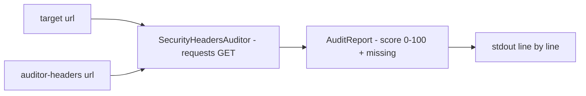

# auditor-headers-seguranca

**English** · [Português (Brasil)](README.md)

[](#) [](#) [](#) [](LICENSE)

## What it is

**An HTTP security-headers auditor**: it queries a URL and checks the presence of the 5 essential security headers — `Content-Security-Policy`, `Strict-Transport-Security`, `X-Frame-Options`, `X-Content-Type-Options`, `Referrer-Policy` — and returns a **0–100 score** proportional to the ones present. It is an educational web-hardening lab.

## Status

An educational lab, working and tested (5 tests).

## Features

- **Audit** (`auditor.py`): `SecurityHeadersAuditor` — fetches the URL (requests) and builds an `AuditReport` with `score (0-100)`, `present/total`, `missing` and a `HeaderResult` per header.
- **Audited headers**: `SECURITY_HEADERS = (Content-Security-Policy, Strict-Transport-Security, X-Frame-Options, X-Content-Type-Options, Referrer-Policy)`.
- **Percentage** (`AuditReport.percentage`): present/total × 100.
- **CLI** (`__main__.py`): `auditor-headers <url>` prints the report line by line.

## Architecture

An `auditor_headers_seguranca` package with `auditor.py` (core: checked headers + report) and `__main__.py` (CLI/formatting).



## Stack

- Python ≥ 3.10
- requests ≥ 2.31 (only dependency)
- pytest (dev)

## Repository layout

```
auditor-headers-seguranca/
├── pyproject.toml · BRIEF.md
├── src/auditor_headers_seguranca/
│   ├── auditor.py    # SECURITY_HEADERS + Auditor/Report
│   └── __main__.py   # CLI
├── tests/            # 5 tests
└── LICENSE           # MIT
```

## Prerequisites and installation

```bash
pip install -e .
```

## How to run

```bash
auditor-headers https://example.com
```

## Tests and quality

Real command (verified by the agent):

```bash
PYTHONPATH=src python -m pytest tests/
# 5 passed
```

## Technical decisions and trade-offs

- **Simple proportional score** (present/total): easy to interpret; it does not weight each header's criticality.
- **5 essential headers**: focused on the OWASP Secure Headers basics; it does not cover Expect-CT (obsolete) or cache headers.

## Known limitations and roadmap

- Response headers only (it does not deep-audit TLS, cookies or the CSP policy itself).
- The URL must answer HTTP; bot-blocked sites may deny the read.

## Development process

An individual project by Kelvin Oliveira, built with orchestrated AI agents and reviewed by the author.

## License and author

MIT — Copyright (c) 2026 Kelvin Rebelo de Oliveira. Author: [Kelvin Oliveira](https://github.com/KelvinOliveiraCode) · [Portfolio](https://kelvinoliveiracode.github.io/portfolio/)
