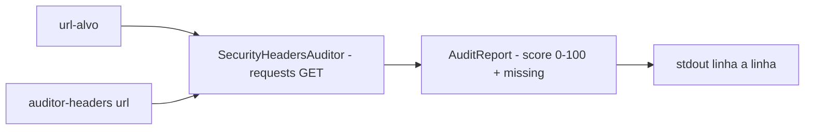

# auditor-headers-seguranca

[English](README.en.md) · **Português (Brasil)**

[](#) [](#) [](#) [](LICENSE)

## O que é

**Auditor de headers de segurança HTTP**: consulta uma URL e verifica a presença dos 5 headers de segurança essenciais — `Content-Security-Policy`, `Strict-Transport-Security`, `X-Frame-Options`, `X-Content-Type-Options`, `Referrer-Policy` — e dá uma **pontuação de 0 a 100** proporcional aos presentes. É um laboratório educacional de hardening web.

## Status

Laboratório educacional funcional e testado (5 testes).

## Funcionalidades

- **Auditoria** (`auditor.py`): `SecurityHeadersAuditor` — consulta a URL (requests) e monta um `AuditReport` com `score (0-100)`, `present/total`, `missing` e `HeaderResult` por header.
- **Headers auditados**: `SECURITY_HEADERS = (Content-Security-Policy, Strict-Transport-Security, X-Frame-Options, X-Content-Type-Options, Referrer-Policy)`.
- **Percentual** (`AuditReport.percentage`): presença/total × 100.
- **CLI** (`__main__.py`): `auditor-headers <url>` imprime o relatório linha a linha.

## Arquitetura

Pacote `auditor_headers_seguranca` com `auditor.py` (núcleo: headers checkados + report) e `__main__.py` (CLI/formatação).



## Stack

- Python ≥ 3.10
- requests ≥ 2.31 (única dependência)
- pytest (dev)

## Estrutura do repositório

```
auditor-headers-seguranca/
├── pyproject.toml · BRIEF.md
├── src/auditor_headers_seguranca/
│   ├── auditor.py    # SECURITY_HEADERS + Auditor/Report
│   └── __main__.py   # CLI
├── tests/            # 5 testes
└── LICENSE           # MIT
```

## Pré-requisitos e instalação

```bash
pip install -e .
```

## Como executar

```bash
auditor-headers https://exemplo.com
```

## Testes e qualidade

Comando real (verificado pelo agente):

```bash
PYTHONPATH=src python -m pytest tests/
# 5 passed
```

## Decisões técnicas e trade-offs

- **Score proporcional simples** (presentes/total): fácil de interpretar; não pondera a criticidade de cada header.
- **5 headers essenciais**: foco no básico de OWASP Secure Headers; não cobre Expect-CT (obsoleto) nem headers de cache.

## Limitações conhecidas e roadmap

- Só headers de resposta (não audita TLS a fundo, coleta de cookies ou CSP detalhada).
- A URL deve responder HTTP; sites com bloqueio de bots podem impedir a leitura.

## Processo de desenvolvimento

Projeto individual de Kelvin Oliveira, construído com agentes de IA orquestrados e revisado pelo autor.

## Licença e autor

MIT — Copyright (c) 2026 Kelvin Rebelo de Oliveira. Autor: [Kelvin Oliveira](https://github.com/KelvinOliveiraCode) · [Portfólio](https://kelvinoliveiracode.github.io/portfolio/)
